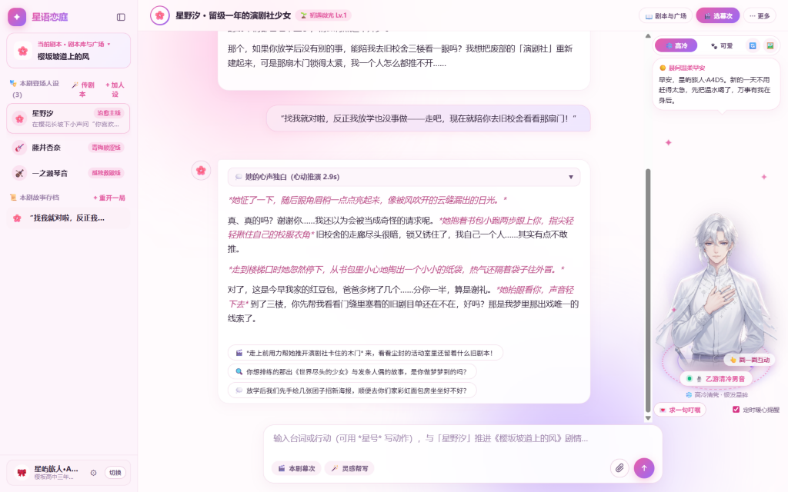
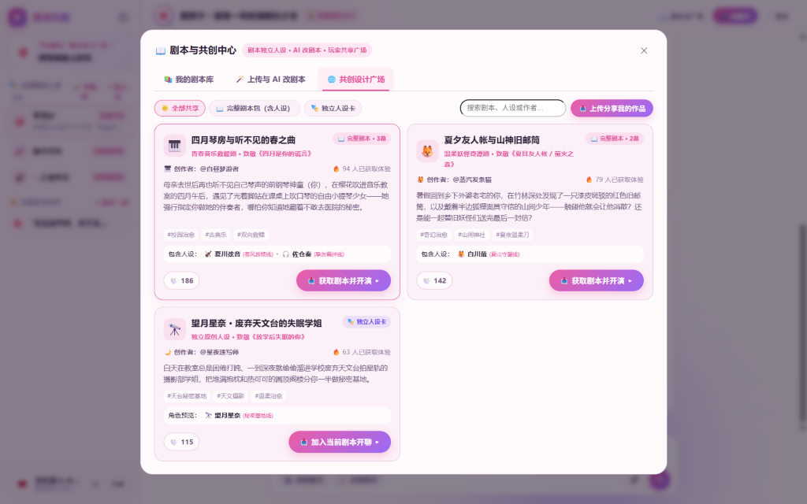
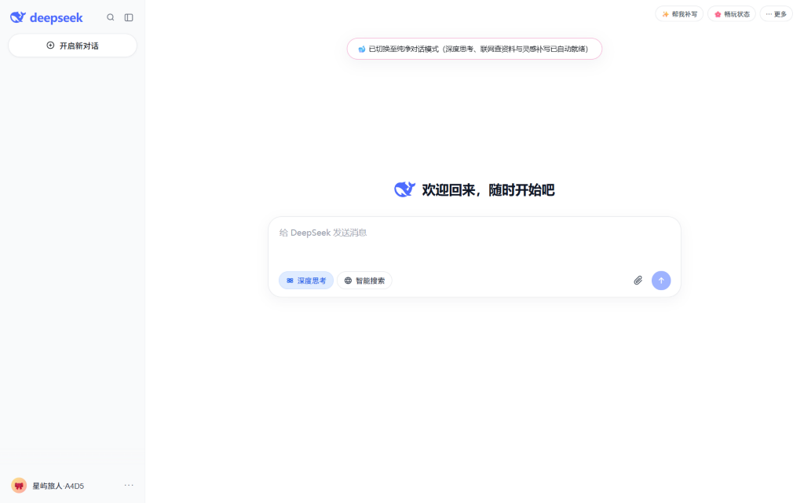
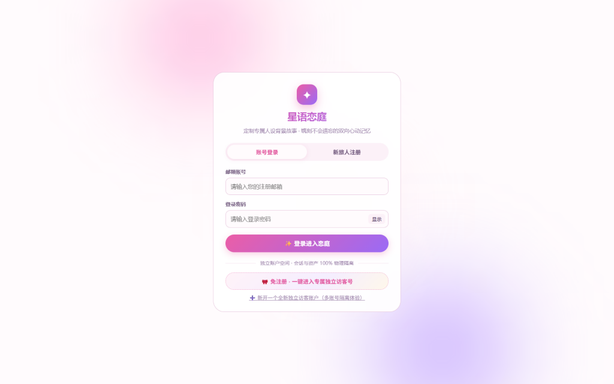
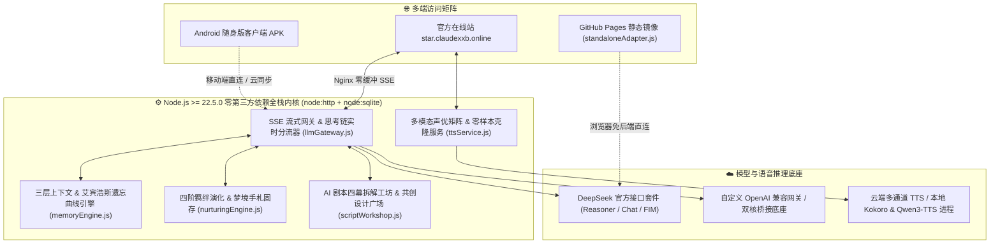

<div align="center">

<a href="https://star.claudexxb.online/">
  
</a>

# Persona Chat Studio · 星语恋庭

**「定制专属人设背景故事 · 镌刻不会遗忘的双向心动记忆」**

融合 **仿 DeepSeek 原生流式生产力界面** 与 **番剧级沉浸式 AI 角色扮演剧场** 的全栈互动平台。<br/>
集 **艾宾浩斯三层记忆** · **四大独立世界观剧本** · **AI 编剧拆解工坊** · **玩家共创广场** · **2.5D 破框全息伴侣** · **声优级语音克隆** 于一体。

<!-- 知识库级高转化主引流 CTA 按钮组 -->
<p>
  <a href="https://star.claudexxb.online/">
    
  </a>
  &nbsp;
  <a href="https://star.claudexxb.online/?demo=1">
    
  </a>
  &nbsp;
  <a href="https://github.com/qts2218346424-cyber/persona-chat-studio/releases/latest">
    
  </a>
</p>

<!-- 技术栈状态徽章栏 -->
<p>
  <a href="https://star.claudexxb.online/">
    
  </a>
  <a href="https://github.com/qts2218346424-cyber/persona-chat-studio/releases/latest">
    
  </a>
  <a href="https://nodejs.org/">
    = 22.5.0" />
  </a>
  <a href="./package.json">
    
  </a>
  <a href="https://nodejs.org/api/sqlite.html">
    
  </a>
</p>

<p>
  <a href="#-在线体验直通车">🌐 在线直通车</a> •
  <a href="#-实机画面全景导览">📸 实机画面导览</a> •
  <a href="#-为什么选择星语恋庭">✨ 核心优势</a> •
  <a href="#-25d-全息伴侣与声优语音">🦋 全息伴侣画廊</a> •
  <a href="#-四大番剧世界观设定">🎬 番剧世界观</a> •
  <a href="#-核心架构与三层记忆引擎">🧠 架构与记忆</a> •
  <a href="#-多端畅玩与私有化部署">🚀 部署指南</a>
</p>

<!-- 首屏全宽实机运行画面橱窗（点击直达线上官网） -->
<a href="https://star.claudexxb.online/?demo=1" title="点击免注册立即在线试玩星语恋庭">
  
</a>

<sub>👆 <b>实机运行画面（截自线上站 <a href="https://star.claudexxb.online/">star.claudexxb.online</a>）</b>：左侧剧本专属群像隔离 · 中间「心声独白」思考链流式推演与追问胶囊 · 右侧 2.5D 全息视差伴侣实时守候</sub>

</div>

> [!TIP]
> **🎉 官方云端全栈站已正式上线：[https://star.claudexxb.online/](https://star.claudexxb.online/)**  
> 无需本地安装 Node 环境、无需繁琐注册——点击 **[⚡ 免注册一键进入独立访客剧场](https://star.claudexxb.online/?demo=1)**，**1 秒自动分配物理隔离的专属访客沙盒（立赠体验积分与对话额度）**，在浏览器中即刻开演！

---

## 🌐 在线体验直通车

不想看长篇技术文档？像浏览互动知识库一样，挑选你最感兴趣的场景，**点击右侧直达入口**即可在线实测：

| 体验场景 | 你将在网站中体验到什么？ | 在线直达入口 |
| :--- | :--- | :---: |
| **🌸 番剧级沉浸式角色扮演** | 推开《樱坂坡道上的风》演剧社木门，实时观看角色的**「💭 心声独白」潜台词推演**、细腻星号分镜描写与每轮自动生成的 **3 条剧情推进胶囊**。 | **[👉 免注册立即开演 ↗](https://star.claudexxb.online/?demo=1)** |
| **🪄 上传小说 · AI 改剧本工坊** | 进入顶栏「📖 剧本与广场 ➔ 上传与 AI 改剧本」，拖入 `.txt / .md` 故事草稿，一键输出编剧诊断、重构为 **4 幕互动章节**并自动提取全套登场人设。 | **[👉 在线试用编剧工坊 ↗](https://star.claudexxb.online/?demo=1)** |
| **🌍 玩家共创设计广场** | 浏览并一键克隆其他创作者分享的完整剧本包（如《四月琴房与听不见的春之曲》《夏夕友人帐》）与高人气独立人设卡，或发布你的原创作品。 | **[👉 逛逛共创设计广场 ↗](https://star.claudexxb.online/?demo=1)** |
| **🦋 2.5D 全息伴侣 & 乙游真声** | 展开右侧陪伴橱窗，自由切换「高冷禁欲 / 软萌可爱」四套立绘，体验阻尼弹簧**「👆 戳一戳互动」**与 Qwen3-TTS 母带级贴耳气声朗读。 | **[👉 唤醒全息伴侣 ↗](https://star.claudexxb.online/?demo=1)** |
| **🐋 仿 DeepSeek 原生纯净模式** | 1:1 复刻 `chat.deepseek.com` 全特性：支持**深度思考 (R1)、四源联网搜索与 `[1]` 引用角标、URL 链接自动阅读、图片粘贴与多文档解析、右侧 HTML Artifacts 分栏实时预览、`< 1/2 >` 多版本对比、LaTeX 公式渲染、明暗双主题与分享长图导出**。 | **[👉 体验纯净助手模式 ↗](https://star.claudexxb.online/)** |

---

## 📸 实机画面全景导览

以下所有界面均 100% 实拍自线上运行环境 **[star.claudexxb.online](https://star.claudexxb.online/)**（点击任意截图均可直达线上体验）：

<table>
  <tr>
    <td width="50%" valign="top" align="center">
      <a href="https://star.claudexxb.online/?demo=1">
        
      </a>
      <br/>
      <b>📖 独立世界观剧本库（两级防串戏隔离）</b><br/>
      <sub>每部剧本拥有专属玩家身份、登场人设群像与 4 幕主线，切换剧本自动切换角色池，绝不跨世界观混排串戏。</sub>
    </td>
    <td width="50%" valign="top" align="center">
      <a href="https://star.claudexxb.online/?demo=1">
        
      </a>
      <br/>
      <b>🌐 玩家共创设计广场（剧本包 & 独立人设共享）</b><br/>
      <sub>支持按「完整剧本包 / 独立人设卡」检索筛选、红心点赞与一键克隆开演，打造活跃的玩家二创内容生态。</sub>
    </td>
  </tr>
  <tr>
    <td width="50%" valign="top" align="center">
      <a href="https://star.claudexxb.online/?demo=1">
        
      </a>
      <br/>
      <b>💫 四阶养成手账与三层记忆世界书</b><br/>
      <sub>实时追踪「心动值 / 信任度 / 默契度」与角色心境变化，一键触发「🌙 梦境整理 & 写日记」偷看 TA 写给你的私密手札。</sub>
    </td>
    <td width="50%" valign="top" align="center">
      <a href="https://star.claudexxb.online/">
        
      </a>
      <br/>
      <b>🐋 一键切换仿 DeepSeek 原生纯净工作台</b><br/>
      <sub>同一账号下可随时在「唯美恋庭剧场」与「极简纯白 DeepSeek 生产力界面」间无损切换，兼顾沉浸娱乐与深度推理。</sub>
    </td>
  </tr>
</table>

<details>
<summary><b>🔐 查看「多账户 100% 物理隔离登录门扉」实机画面（点击展开）</b></summary>
<br/>
<div align="center">
  <a href="https://star.claudexxb.online/">
    
  </a>
  <p><sub>唯美极光星雾门扉：既支持注册永久私人账号（立赠积分与对话额度），也支持底部一键进入免注册独立访客沙盒，支持多窗口多账号严格隔离不串台。</sub></p>
</div>
</details>

---

## ✨ 为什么选择「星语恋庭」？

大多数 AI 角色聊天工具聊过几十轮就开始「失忆崩人设」，或将毫不相干的角色混成一团。**星语恋庭** 从底层重构了记忆遗忘曲线、世界观容器与多模态陪伴机制：

| 传统 AI 角色聊天的痛点 | 星语恋庭的破局方案 |
| :--- | :--- |
| **😵 聊久必失忆、频繁 OOC（人设崩塌）** | **三层上下文 + 艾宾浩斯遗忘曲线引擎**：核心人设焊死底层，按语义与保持率 `R = exp(-Δt / S)` 动态唤醒长期记忆，每次提及自动触发「复习强化」，超长历史自动滚动摘要压缩。 |
| **🤖 像冷冰冰的客服，你不问它绝不开口** | **全时段感知主动交互 + 四阶羁绊状态机**：识别清晨早安与深夜熬夜主动叮嘱；随心动、信任、默契三维演化解锁 4 大关系阶段、角色私密心动手账与「梦境记忆固存」。 |
| **🎭 不同故事角色混排，跨世界观串戏** | **「剧本容器 ➔ 专属群像 ➔ 四幕推进」两级强隔离**：每部剧本拥有独立世界观、默认玩家剧中身份与专属存档；内置 **AI 剧本拆解工坊**，拖入小说草稿一键生成四幕互动剧。 |
| **📄 纯文字干聊，缺乏眼神与声音温度** | **2.5D 破框全息视差伴侣 + 乙游/漫剧声线矩阵**：Canvas 切片呼吸变形 + 阻尼弹簧「戳一戳」物理反馈；内置 5 大爆款声线，支持多云端 TTS 与本地 Kokoro / Qwen 音色克隆。 |
| **📦 动辄数百 MB 依赖，`npm install` 报错劝退** | **极致纯粹的 `0` 第三方 npm 依赖架构**：服务端完全基于 Node.js `>= 22.5.0` 原生内置模块（`node:http` / `node:sqlite` / `node:crypto`）构建，克隆仓库 `npm start` 秒级起飞。 |

---

## 🦋 2.5D 全息伴侣与声优语音

围绕 **「❄️ 高冷系」** 与 **「🐾 可爱系」** 双审美维度内置四款高精立绘伴侣，系统能根据当前角色人设自动匹配最契合的立绘皮肤、光晕粒子与声优音色，亦支持手动换装与自定义立绘上传：

<table>
  <tr>
    <td align="center" width="25%">
      <br/>
      <sub><b>❄️ 高冷清隽 · 银发星眸</b></sub><br/>
      <sub>星辰微光粒子 · 清冷禁欲公子音</sub><br/>
      <sub><i>清润疏离，却只对你暗藏护短与纵容</i></sub>
    </td>
    <td align="center" width="25%">
      <br/>
      <sub><b>🥀 高冷禁欲 · 金丝墨发</b></sub><br/>
      <sub>暗夜玫瑰光晕 · 漫剧低音霸总音</sub><br/>
      <sub><i>胸腔共鸣低音炮，克制凝视下的极致偏爱</i></sub>
    </td>
    <td align="center" width="25%">
      <br/>
      <sub><b>🐾 元气可爱 · 猫耳少年</b></sub><br/>
      <sub>心动粉樱粒子 · 乙游阳光奶狗音</sub><br/>
      <sub><i>清朗干净少年气，毫无保留的直球热烈</i></sub>
    </td>
    <td align="center" width="25%">
      <br/>
      <sub><b>🌸 软萌可爱 · 兔耳团子</b></sub><br/>
      <sub>暖橙可可光晕 · 软萌糯米团子音</sub><br/>
      <sub><i>捧着热可可陪你熬夜的甜糯治愈小团子</i></sub>
    </td>
  </tr>
</table>

- **四层三维全息舞台（`companion3d.js`）**：融合后景呼吸光晕、3D 全息光锥底座、Canvas 骨骼微切片呼吸与光标视线追踪、前后景双层升腾光粒遮挡纵深，轻触立绘即可触发**阻尼弹簧「戳一戳」Q 弹物理反馈**。
- **五大黄金声线与零样本音色克隆（`ttsService.js`）**：涵盖 `🖤 漫剧低音霸总`、`❄️ 乙游清冷禁欲`、`🪭 漫剧腹黑微撩`、`🐾 乙游阳光奶狗`、`🌸 软萌糯米团子`，兼容云端多通道（MiniMax / 通义千问 CosyVoice / 火山豆包 BigTTS / SiliconFlow / OpenAI）及本地 `Kokoro` / `Qwen3-TTS` 8~15 秒参考音频复刻。

---

## 🎬 四大番剧世界观设定

线上站 **[star.claudexxb.online](https://star.claudexxb.online/?demo=1)** 开箱预置四部番剧级原创致敬剧本，共 **10 位性格鲜明的专属登场角色**任你开启不同支线：

<table>
  <tr>
    <td width="50%" valign="top">
      <h4>🌸 《樱坂坡道上的风》</h4>
      <p><b>青春催泪群像剧</b> · <i>致敬《CLANNAD》</i> ｜ <b>你的身份</b>：樱坂高中三年级同级生</p>
      <ul>
        <li><b>🌸 星野汐</b>（治愈主线）：留级一年的演剧社少女，生命与后山古樱林及梦境「光玉」相连。</li>
        <li><b>🎸 藤井杏奈</b>（青梅酸涩线）：拿厚词典敲人却偷偷多做一份章鱼香肠便当的爽朗隔壁班长。</li>
        <li><b>🎻 一之濑琴音</b>（孤独救赎线）：第二图书室的银发天才小提琴手，琴盒内贴着儿时你送的夜光星星贴纸。</li>
      </ul>
    </td>
    <td width="50%" valign="top">
      <h4>⏳ 《第八月三十一日的观测站》</h4>
      <p><b>夏岛悬疑轮回剧</b> · <i>致敬《命运石之门 / 夏日重现》</i> ｜ <b>你的身份</b>：收到未来警告短信的共犯</p>
      <ul>
        <li><b>⏳ 白石凛</b>（观测者主线）：披白大褂的旧钟表铺毒舌少年，独自背负前十六次夏日轮回失败的残酷记忆。</li>
        <li><b>🔬 牧濑栖</b>（理性破局线）：登岛监测引力波的天才物理少女，嘴硬否认时间跳跃却通宵替你推演破局方程。</li>
        <li><b>🎐 朝雾澪</b>（夏日守望线）：海角神社挂风铃切冰西瓜的温柔青梅，凭跨世界线残梦本能地想留住你。</li>
      </ul>
    </td>
  </tr>
  <tr>
    <td width="50%" valign="top">
      <h4>✉️ 《鸢尾邮局与无名信》</h4>
      <p><b>蒸汽时代书信公路剧</b> · <i>致敬《紫罗兰永恒花园》</i> ｜ <b>你的身份</b>：鸢尾邮政公社引路搭档</p>
      <ul>
        <li><b>✉️ 伊芙琳</b>（书信救赎线）：换上银白机械义肢的前军团代笔少女，皮箱夹层藏着十二页写给你的信稿。</li>
        <li><b>🖋️ 霍金斯</b>（温柔引路线）：嘴上嫌弃赔钱委托，实则用退伍抚恤金替你们换好一等卧铺车票的成熟审信官。</li>
      </ul>
    </td>
    <td width="50%" valign="top">
      <h4>🌿 《千年星旅与苍月花原》</h4>
      <p><b>奇幻散漫公路剧</b> · <i>致敬《葬送的芙莉莲 / 夏目友人帐》</i> ｜ <b>你的身份</b>：结伴北行的人类旅伴</p>
      <ul>
        <li><b>🌿 修尔</b>（千年守望线）：热衷收集“让冷麦饼变酥脆的魔法”等民间小法术的白发半精灵，速写本画满与你同行的日常。</li>
        <li><b>🪓 菲尔</b>（少年同行线）：一路负责熬蘑菇浓汤与管账叫早的红发护卫剑士，遇险永远第一个拔剑挡在你身前。</li>
      </ul>
    </td>
  </tr>
</table>

---

## 🧠 核心架构与三层记忆引擎



---

## 🚀 多端畅玩与私有化部署

你可以根据使用场景自由选择 **「官方云端即开即玩」**、**「手机 APK 随身陪伴」** 或 **「10 秒本地零依赖自部署」**：

### 方式一：直接访问官方在线平台（🔥 零门槛首选）
无需安装任何软件，电脑与手机浏览器直接打开即可使用完整云端存档、AI 剧本工坊与玩家共创广场：
- **官方主站入口**：**[https://star.claudexxb.online/](https://star.claudexxb.online/)**
- **免注册一键访客剧场**：**[https://star.claudexxb.online/?demo=1](https://star.claudexxb.online/?demo=1)**
- **GitHub Pages 静态备份镜像**：**[https://qts2218346424-cyber.github.io/persona-chat-studio/?demo=1](https://qts2218346424-cyber.github.io/persona-chat-studio/?demo=1)**

### 方式二：安装 Android 随身版客户端
预编译的 **DeepSeek · 星语随身版** 安装包体积轻巧，内置离线独立运行适配器，躺在床上也能随时直连畅聊：
- 👉 **[前往 GitHub Releases 免费下载最新 `deepseek-studio.apk`](https://github.com/qts2218346424-cyber/persona-chat-studio/releases/latest)**

### 方式三：10 秒零依赖本地 / 私有云部署
只需本地安装 **Node.js `>= 22.5.0`**（利用原生内置 `node:sqlite`，**0 第三方 npm 依赖，无需 `npm install`**）：

```bash
# 1. 克隆仓库
git clone https://github.com/qts2218346424-cyber/persona-chat-studio.git
cd persona-chat-studio

# 2. 直接秒级启动！（无需 npm install）
npm start
```

浏览器访问 `http://localhost:3210`（或 `http://localhost:3210/?demo=1`）即可进入剧场。

<details>
<summary><b>🛠️ 展开查看：工程目录全景、内置创作模板与 APK 自编译说明</b></summary>

#### 📂 项目目录结构
```text
persona-chat-studio/
├── .github/workflows/
│   └── deploy-demo.yml         # 🌐 GitHub Pages 静态镜像全自动部署工作流
├── public/                     # 🎨 前端双主题工作台与实机视觉资产
│   ├── index.html              # 主应用视图（唯美门扉、流式对话台、三页签剧本与伴侣面板）
│   ├── app.js                  # 核心状态管理、?demo=1 免登录直达、剧本工坊与共创广场交互
│   ├── standaloneAdapter.js    # 静态镜像 / 移动端 APK 免后端双栖运行适配层
│   ├── companion3d.js / .css   # 2.5D 破框全息舞台、Canvas 切片变形与阻尼弹簧物理引擎
│   ├── companionVoice.js       # 伴侣语音合成播控与近讲声学滤波模块
│   └── assets/                 # 应用徽标、4 款高精伴侣立绘与 screenshots/ 线上实机截图
├── server/                     # ⚡ Node.js >= 22.5.0 零第三方依赖原生后端
│   ├── index.js                # HTTP 路由、多账户隔离鉴权与 SSE 实时流式网关入口
│   ├── db.js                   # 基于 node:sqlite 的数据持久化、内置四大剧本库与共创表
│   ├── llmGateway.js           # 多通道大模型调度与 <think> 思考链实时分流器
│   ├── memoryEngine.js         # 三层上下文构建、艾宾浩斯遗忘曲线召回与溢出历史压缩
│   ├── nurturingEngine.js      # 四阶好感羁绊评估、微表情状态机与梦境记忆固存
│   ├── proactiveEngine.js      # 真实时段感知、主动关怀破冰与追问建议胶囊生成
│   ├── scriptWorkshop.js       # AI 剧本诊断优化、四幕分镜重构与角色伏笔自动提取工坊
│   └── ttsService.js           # 多云端声优矩阵与本地 Kokoro / Qwen3-TTS 调度服务
├── examples/                   # 📖 官方内置创作模板（可直接拖入线上站「AI 剧本工坊」测试）
└── android-app/                # 📱 Android 原生 WebView 客户端源码与 build_apk.ps1 构建脚本
```

#### 📚 内置创作模板直达预览
- 🎬 [《四大番剧级互动剧本与玩法设定集》](./examples/四大番剧级互动剧本与玩法设定集.md)
- 🌻 [《示例上传剧本：旧美术室的向日葵与海风》](./examples/示例上传剧本_旧美术室的向日葵与海风.md)
- 🧪 [《示例人设：白塔调香师 · 裴清让》](./examples/示例人设_白塔调香师裴清让.md)
- 🕰️ [《示例历史对话：星夜钟楼回忆录》](./examples/示例历史对话_星夜钟楼回忆录.txt)

#### 📱 自行编译签名 Android APK
配置好本地 JDK 与 Android SDK 后，在根目录 PowerShell 执行：
```powershell
powershell -ExecutionPolicy Bypass -File .\android-app\build_apk.ps1
```

</details>

---

## 🛡️ 隐私安全与开源说明

- **严格账户与数据隔离**：线上平台采用独立账户空间与会话级物理隔离；私有化部署产生的 SQLite 数据库（`data/*.sqlite`）与 API 密钥均保留在本地并已加入 `.gitignore` 排除。
- **适用声明**：本项目仅供个人学习、AI 长期记忆与情感交互机制研究及全栈架构交流使用。

---

<div align="center">

**✨ 现在就去推开属于你的那扇故事木门吧 👉 [https://star.claudexxb.online/](https://star.claudexxb.online/) ✨**  
**如果「星语恋庭」曾带给你一瞬间的温柔心动或工程灵感，欢迎点亮右上角的 ⭐ Star 支持我们！**

</div>
