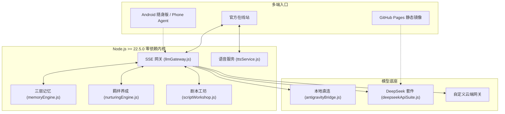

<div align="center">

<a href="https://star.claudexxb.online/">
  
</a>

# Persona Chat Studio · 星语恋庭

**「定制专属人设背景故事 · 镌刻不会遗忘的双向心动记忆」**

集 **🐋 仿 DeepSeek 原生生产力工作台** · **🌸 高阶沉浸式角色扮演剧场** · **📱 Android 随身版与 Phone Agent 手机辅助代理** 于一体的零依赖全栈平台。<br/>
内置 **三通道独立隔离连接中心** · **艾宾浩斯三层记忆引擎** · **五大独立世界观剧本** · **AI 编剧拆解工坊** · **玩家共创广场** · **皮肤与头像捏脸工坊** · **十档声优语音**。

<p>
  <a href="https://star.claudexxb.online/">
    
  </a>
  &nbsp;
  <a href="https://github.com/qts2218346424-cyber/persona-chat-studio/releases/latest">
    
  </a>
</p>

<p>
  
  = 22.5.0" />
  
  
  
</p>

<p>
  <a href="#-v270-最新版本核心特性">🚀 最新特性</a> •
  <a href="#-三大工作台">🌐 三大工作台</a> •
  <a href="#-外观皮肤与头像工坊">🎨 外观工坊</a> •
  <a href="#-五大内置剧本与-20-位角色">🎬 剧本角色</a> •
  <a href="#-连接中心与声优语音">🔌 连接与语音</a> •
  <a href="#-核心架构与记忆引擎">🧠 架构记忆</a> •
  <a href="#-部署与构建">🛠️ 部署</a>
</p>

<a href="https://star.claudexxb.online/" title="点击直达星语恋庭官方在线站">
  
</a>

</div>

---

## 🚀 v2.7.0 最新版本核心特性

1. **AI 操作学习固化与本地免 API 离线回放**：用 API 模式跑通固定流程后，可一键将操作步骤固化为本地技能（支持名称/口令编辑与步骤微调），后续在「本地免 API」模式与桌面悬浮窗中零消耗直接离线运行（文本/节点/自适应相对坐标三重抗漂移定位）。
2. **三模式 API 配置 100% 物理隔离 + 默认本地直连**：DeepSeek 聊天模式、星语剧场（剧情模式）与手机辅助三端彻底隔离，各自拥有独立的简洁设置弹窗与存储空间；默认状态下 DeepSeek 聊天与星语剧场均保持「本地直连模式」，互不覆盖串用。
3. **手机辅助主页与原生悬浮窗焕新**：遵循 `myui` 规范重塑手机辅助主页面与本地技能工作台；Android 原生悬浮窗重构为「控屏 / 大肥鱼 / 设置」三段式暗夜微光玻璃态面板，新增已学技能快捷胶囊区，交互更简洁克制。

1. **经典 QQ 聊天默认主题 & 抽屉高对比度全面修复**：新增全端通用 **`经典 QQ 聊天 (qq-classic)`** 默认皮肤主题（`#F2F3F5` 洁净灰底 + `#FFFFFF` 纯白逐句分段气泡 + `#1677FF` QQ 标志蓝己方气泡），支持在桌面/手机设置一键切换默认主题；全面重做右侧「系统指令 / 养成 / 记忆档案」抽屉 `light-dark(...)` 高对比令牌体系，彻底解决浅色白卡上标签与按钮字看不清问题。
2. **删去多余歌词尾巴 & QQ 音乐状态栏歌词真同步**：彻底去除折叠态肥鱼旁拖着的黑底歌词尾巴及桌面暂无歌词空提示尾巴；自动拆解开启状态栏/灵动岛歌词时 `title=歌词一句`、`artist=歌名-歌手` 的反转元数据，上方歌名下方纯歌词流畅同步。
2. **大肥鱼去僵硬自然慢漫步 & 搞怪捣蛋微剧本**：重塑底部贴地重心果冻呼吸与小碎步挤压回弹动画，漫步改为悠闲弧线慢走；外置交互栏与展开面板均配备 **`😈闹 / 😈捣蛋`**，演出打滑翻滚 360°、倒立吐舌鬼脸、吹大泡泡吓一跳、偷啃算力、装睡惊醒、后仰撞屏等 6 套滑稽细节动作。
3. **外卖进度实时同步 & 蹲守催餐互动**：支持通知监听与无障碍自动捕获美团、饿了么、京东秒送、淘宝闪购等配送阶段（接单 / 备餐 / 取餐配送 / 逼近 / 送达），面板新增专属 **`🛵 外卖卡片`** 与 **`🛵查外卖`**，大肥鱼跟着一起流口水等开饭！
4. **QQ 音乐点歌精准锁定「单曲」列表 & 真实歌声 & 外置互动条**：跳过歌手/歌单卡下移直击「单曲」起播、支持多选导入真实音频告别电子哼调、悬浮窗外置肥鱼互动条与不抢焦点快捷打字条同步升级至 `v2.5.7 (Build 154)`。
5. **三通道独立隔离连接中心与极速预压缩管线**：本地直连 / DeepSeek 官方 API / 自定义云端 API 独立切换，`scripts/build-static-assets.mjs` 全面提供 `.gz` 与 `.br` 极速加载。

---

## 🌐 三大工作台

同一账号下，在左侧栏顶部一键切换：

| 工作台 | 核心能力 |
| :--- | :--- |
| **🐋 DeepSeek 原生助手模式** | 1:1 复刻 `chat.deepseek.com`：深度思考链折叠、联网搜索与 `[1]` 引用角标、URL 自动阅读、图片与多文档解析、右侧 HTML Artifacts 实时预览、`< 1/2 >` 多版本切换、LaTeX 公式、明暗主题与长图分享。 |
| **🌸 星语恋庭沉浸剧场模式** | 「💭 心声独白」潜台词流式推演、星号动作分镜、每轮 3 条剧情推进胶囊；五大剧本、AI 编剧工坊、共创广场、四阶羁绊养成与声优朗读。 |
| **📱 手机辅助模式（Phone Agent）** | Android 随身版专属：常驻悬浮球与一键急停、无障碍屏幕感知与手势模拟、免 API 本地指令（回桌面 / 返回 / 下滑 / 截屏 / 打开应用等）、`dsh-Go` 免确认连续执行。 |

---

## 🎨 外观皮肤与头像工坊

由 `appearanceSystem.js` 与 `appearance.css` 提供，所有项目全部免费开放：

| 模块 | 内容 |
| :--- | :--- |
| **7 套主题皮肤** | 系统默认 · 曜石流金 · 晨雾丝绸 · 朝雾樱白 · 绯红古卷 · 赛博霓虹 · 极简墨水屏 |
| **壁纸与配色** | 7 款内置渐变壁纸、本地壁纸上传、从壁纸智能提取主色、8 色强调色与自定义取色 |
| **排版调节** | 背景暗角遮罩、毛玻璃模糊度、字号缩放；4 种气泡风格（柔光圆润 / 玻璃拟态 / 极简细框 / 复古信纸）；3 种正文字体 |
| **皮肤分享** | JSON 分享码一键导入导出，并随账号同步到服务端 |
| **头像工坊** | 文字徽章渐变 · 12 款矢量预设 · 7 部位分层 SVG 捏脸（含随机）· Canvas 圆形裁剪上传 · 7 款头像框 · 4 种轮廓形状与心情角标 |

---

## 🎬 五大内置剧本与 20 位角色

| 剧本 | 类型 | 登场角色 |
| :--- | :--- | :--- |
| **💖 心动角色全集** | 一对一沉浸恋爱 | 沈星回（星象馆占星师）· 陆沉（雾港记忆执行官）· 谢清晏（长安世家公子）· 江逾白（昆仑清冷剑尊）· 季燃（电竞天才学弟）· 顾修远（京圈联姻家主）· 苏晚晴（财阀女执政官）· 云知遥（蓬莱清冷神女）· 夏柠萌（插画学妹）· 燕绯羽（夜莺歌姬） |
| **🌸 樱坂坡道上的风** | 青春催泪群像 · 致敬《CLANNAD》 | 星野汐 · 藤井杏奈 · 一之濑琴音 |
| **⏳ 第八月三十一日的观测站** | 夏岛悬疑轮回 · 致敬《命运石之门》 | 白石凛 · 牧濑栖 · 朝雾澪 |
| **✉️ 鸢尾邮局与无名信** | 蒸汽时代书信公路 · 致敬《紫罗兰永恒花园》 | 伊芙琳 · 霍金斯 |
| **🌿 千年星旅与苍月花原** | 奇幻散漫公路 · 致敬《葬送的芙莉莲》 | 修尔 · 菲尔 |

- 每部番剧剧本含 3~4 幕互动章节，剧本与角色池两级隔离，不会串戏。
- **AI 编剧工坊**：上传 `.txt / .md` 故事草稿，一键诊断优化、重构为多幕剧并提取登场人设。
- **共创设计广场**：浏览、点赞并一键克隆其他玩家分享的剧本包与人设卡。

---

## 🔌 连接中心与声优语音

### 三通道连接中心
- **本地直连 / 默认引擎**：通过 `antigravityBridge.js` 桥接本机 Antigravity 宿主，支持深度思考流式拆分，免 Key 开箱即用。
- **DeepSeek 官方 API**：只需粘贴 `sk-...` 密钥，自动锁定官方端点，支持测试连接、余额查询与用量监控。
- **云端 API（自定义）**：独立保存接口地址、模型名与密钥，内置硅基流动 / 阿里云百炼 / OpenRouter / Google Gemini 预设。

### 声优语音
- 按角色性别与气质自动匹配十档声线（暗夜低音霸总、治愈民谣男音、清冷叙事公子、腹黑微撩公子、沉稳绅士家主、阳光电竞少年、高冷清艳御姐、清冷仙侠师姐、二次元甜妹、二次元软萌团子）。
- 云端多通道（MiniMax / 通义千问 / 火山豆包 / SiliconFlow / OpenAI）与本地 Edge-TTS / Kokoro / Qwen3-TTS，支持 8~15 秒参考音频音色克隆。

---

## 🧠 核心架构与记忆引擎



- **核心人设层**：角色卡、世界观规则与玩家身份永久置顶，避免人设崩塌。
- **艾宾浩斯召回层**：按相关度与保持率 `R = exp(-Δt / S)` 召回长期记忆，被提及即强化，多次召回自动固化。
- **事实自动提取**：识别称呼、身份、项目背景等，并按槽位覆盖旧信息、去重。
- **滚动摘要与 `.md` 档案**：超长历史自动压缩，支持导出/导入记忆档案跨会话继承。

---

## 🛠️ 部署与构建

### 在线使用
**[https://star.claudexxb.online/](https://star.claudexxb.online/)**（需注册账号，账号数据严格隔离）

### Android 随身版
👉 **[GitHub Releases 下载最新 APK](https://github.com/qts2218346424-cyber/persona-chat-studio/releases/latest)**，应用内支持检查更新与 SHA-256 校验覆盖安装。

### 本地零依赖部署
需 **Node.js `>= 22.5.0`**，无需 `npm install`：

```bash
git clone https://github.com/qts2218346424-cyber/persona-chat-studio.git
cd persona-chat-studio
npm start
```

浏览器访问 `http://localhost:3210`。修改前端后执行 `npm run build:assets` 重新打包并生成 `.gz` / `.br`。

<details>
<summary><b>📂 工程目录结构与 APK 自编译</b></summary>

```text
persona-chat-studio/
├── .github/workflows/        # GitHub Pages 静态镜像部署
├── scripts/build-static-assets.mjs   # CSS/JS 合并压缩与预压缩
├── public/
│   ├── index.html            # 主视图（三工作台）
│   ├── app.js                # 核心状态、连接配置、工坊与广场
│   ├── appearanceSystem.js   # 皮肤与头像工坊
│   ├── appearance.css / ui-polish-v2.css / theater-luxury.css
│   ├── standaloneAdapter.js  # 静态镜像 / APK 免后端适配
│   ├── mobileAdapter.js      # 移动端抽屉与手势
│   ├── phoneAgent.js         # Phone Agent 调度
│   ├── companionVoice.js     # 声优语音播控与克隆
│   ├── plugins/deepseekUsageMonitor.js
│   ├── dist/                 # 打包产物
│   └── assets/               # 图标、语音样本、截图
├── server/
│   ├── index.js · db.js · envLoader.js
│   ├── antigravityBridge.js · deepseekApiSuite.js · llmGateway.js
│   ├── memoryEngine.js · nurturingEngine.js · proactiveEngine.js
│   ├── scriptWorkshop.js · docImporter.js · fileParser.js
│   ├── companionEngine.js · ttsService.js
│   └── edgeTtsWorker.py · kokoroTtsWorker.py · qwenTtsWorker.py
├── examples/                 # 创作模板
├── deploy/ · deploy_cloud.py # 云端部署
└── android-app/              # WebView + Phone Agent 源码与 build_apk.ps1
```

自编译 APK（需本地 JDK 与 Android SDK）：
```powershell
powershell -ExecutionPolicy Bypass -File .\android-app\build_apk.ps1
```

创作模板：[四大番剧剧本设定集](./examples/四大番剧级互动剧本与玩法设定集.md) · [示例剧本](./examples/示例上传剧本_旧美术室的向日葵与海风.md) · [示例人设](./examples/示例人设_白塔调香师裴清让.md) · [示例历史对话](./examples/示例历史对话_星夜钟楼回忆录.txt)

</details>

---

## 🛡️ 隐私与声明

- 线上平台采用独立账户与会话级隔离；本地部署的 SQLite 数据（`data/*.sqlite`）与 API 密钥均保留在本地，并已加入 `.gitignore`。
- 本项目仅供个人学习、AI 长期记忆与情感交互机制研究及全栈架构交流使用。

<div align="center">

**如果「星语恋庭」曾带给你灵感或温柔时刻，欢迎点亮右上角的 ⭐ Star！**

</div>
