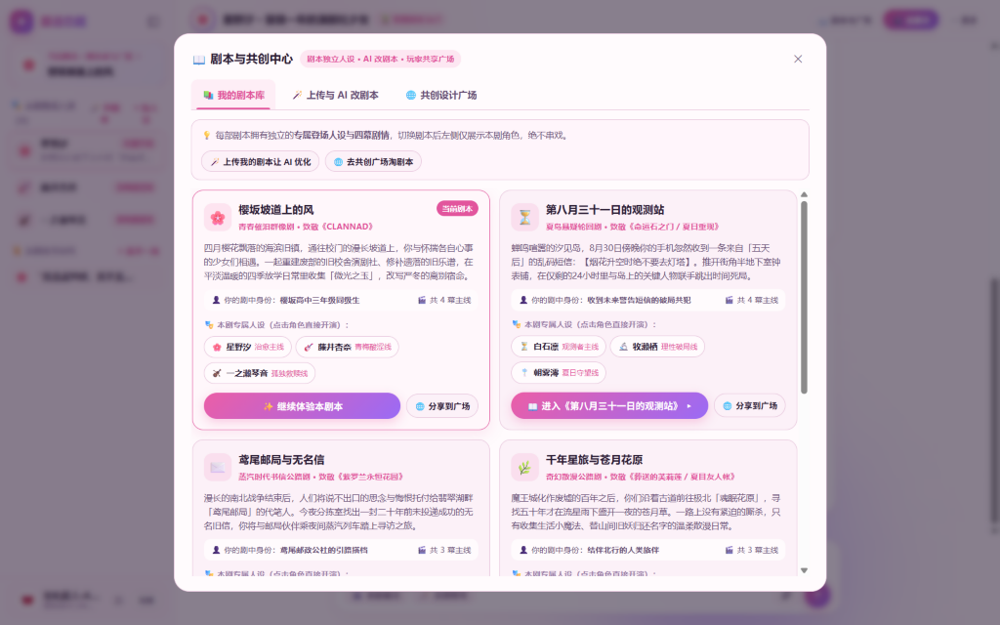
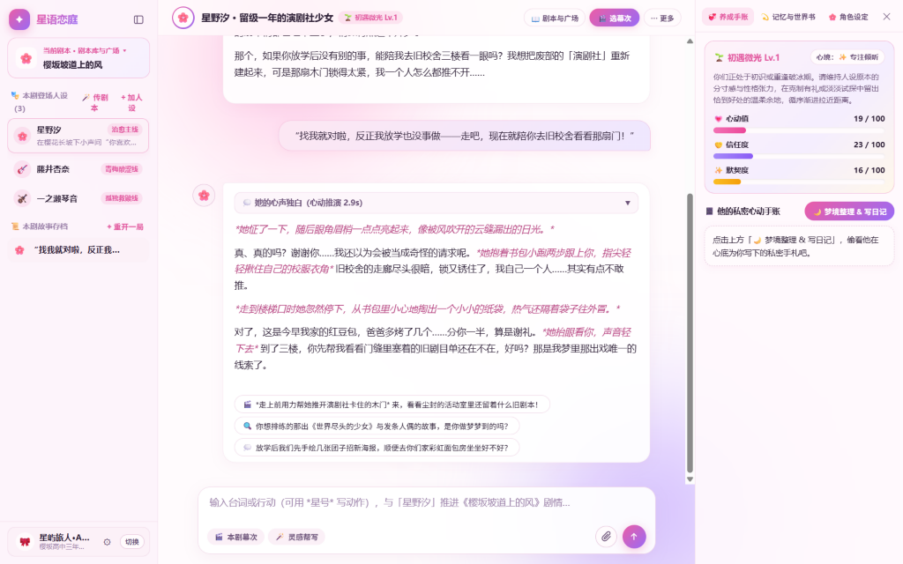
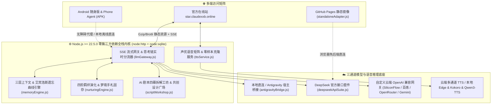

<div align="center">

<a href="https://star.claudexxb.online/">
  
</a>

# Persona Chat Studio · 星语恋庭

**「定制专属人设背景故事 · 镌刻不会遗忘的双向心动记忆」**

集 **🐋 仿 DeepSeek 原生生产力工作台** · **🌸 纯净沉浸式番剧角色扮演剧场** · **📱 Android 随身版与 Phone Agent 手机智能辅助代理** 于一体的零依赖全栈平台。<br/>
内置 **三通道独立隔离连接中心** · **艾宾浩斯三层记忆引擎** · **四大独立世界观剧本** · **AI 编剧拆解工坊** · **玩家共创广场** · **十档乙游/漫剧声优语音**。

<!-- 高转化主引流 CTA 按钮组 -->
<p>
  <a href="https://star.claudexxb.online/">
    
  </a>
  &nbsp;
  <a href="https://star.claudexxb.online/?demo=1">
    
  </a>
  &nbsp;
  <a href="https://github.com/qts2218346424-cyber/persona-chat-studio/releases/latest">
    
  </a>
</p>

<!-- 技术栈状态徽章栏 -->
<p>
  <a href="https://star.claudexxb.online/">
    
  </a>
  <a href="https://github.com/qts2218346424-cyber/persona-chat-studio/releases/latest">
    
  </a>
  <a href="https://nodejs.org/">
    = 22.5.0" />
  </a>
  <a href="./package.json">
    
  </a>
  <a href="https://nodejs.org/api/sqlite.html">
    
  </a>
</p>

<p>
  <a href="#-v20-最新版本核心升级">🚀 v2.0 核心升级</a> •
  <a href="#-三大工作台与体验直通车">🌐 三大工作台</a> •
  <a href="#-实机画面全景导览">📸 实机画面导览</a> •
  <a href="#-三通道连接中心与语音矩阵">🔌 连接与语音</a> •
  <a href="#-四大番剧世界观设定">🎬 番剧世界观</a> •
  <a href="#-核心架构与三层记忆引擎">🧠 架构与记忆</a> •
  <a href="#-多端畅玩与私有化部署">🛠️ 部署指南</a>
</p>

<!-- 首屏全宽实机运行画面橱窗 -->
<a href="https://star.claudexxb.online/" title="点击直达星语恋庭官方在线站">
  
</a>

<sub>👆 <b>最新版本实机画面（截自线上站 <a href="https://star.claudexxb.online/">star.claudexxb.online</a>）</b>：一键在「🐋 仿 DeepSeek 原生生产力工作台」、「🌸 纯净沉浸角色扮演剧场」与「📱 手机辅助模式」间无损切换</sub>

</div>

> [!TIP]
> **🎉 官方云端全栈站已正式上线：[https://star.claudexxb.online/](https://star.claudexxb.online/)**  
> 无需本地安装 Node 环境、无需繁琐注册——点击 **[⚡ 免注册一键进入独立访客剧场](https://star.claudexxb.online/?demo=1)**，**1 秒自动分配物理隔离的专属访客沙盒（立赠体验积分与对话额度）**，在浏览器中即刻体验！

---

## 🚀 v2.0 最新版本核心升级

围绕 **「极致纯净阅读 · 全链路 60fps 流畅度 · 本地/官方/自定义三通道解耦 · 移动端原生随身代理」**，最新版本完成了架构级重塑：

1. **彻底移除立绘功能，回归 100% 纯净故事剧场**：全面剥离冗余立绘遮挡与重型 Canvas 渲染开销，释放完整全宽阅读与沉浸写作视口；桌面端与移动端聚焦「💭 心声独白」实时推演、细腻分镜排版、剧情推进胶囊与高质量对白语音朗读。
2. **三通道完全独立隔离连接中心（`settings` 彻底解耦）**：
   - **⚡ 本地直连 / 默认引擎**：支持本地 Antigravity 宿主极速桥接直连（`antigravityBridge.js`）与深度思考流式推演，开箱免 Key 即用；
   - **🐋 DeepSeek 官方 API 独立通道**：只需 1 步粘贴 `sk-...` 密钥，自动锁定官方端点与 `DeepSeek-V4.1-Flash` / `R1` 模型，内置实时余额查询与用量监控插件（`deepseekUsageMonitor.js`）；
   - **☁️ 云端 API（自定义）独立通道**：与 DeepSeek 官方配置物理隔离，预设**硅基流动、阿里云百炼、OpenRouter、Google Gemini**快捷模板，支持自由填写任意 OpenAI 兼容接口地址与模型名称。
3. **全场景双引擎语音识别输入**：在网页聊天、手机辅助面板与常驻悬浮窗全场景集成语音识别模块，支持浏览器原生语音识别与录音转写双轨切换。
4. **全对话通用「定位聊天」与快捷导航胶囊**：长对话一键返回最上方 / 回到底部，并支持按**关键词、我的提问、AI 回复**快速检索定位到指定对话楼层。
5. **移动端 1:1 DeepSeek 原生全屏设置页 & 极速渲染管线**：重构移动端全屏设置视图与 0ms 开屏推门渲染，引入 `scripts/build-static-assets.mjs` 合并压缩打包与 `.gz` / `.br` 静态预压缩产物，实现秒开零卡顿体验。

---

## 🌐 三大工作台与体验直通车

同一账号与数据底座下，支持在左侧栏顶部一键切换三种截然不同的工作台形态：

| 工作台模式 | 核心能力与最新特性 | 在线直达入口 |
| :--- | :--- | :---: |
| **🐋 DeepSeek 原生助手模式** | 1:1 复刻 `chat.deepseek.com` 全特性：深度思考链 (`<think>`) 折叠推演、四源联网搜索与 `[1]` 角标引用、URL 网页自动抓取阅读、图片粘贴与多文档解析、右侧 HTML Artifacts 实时沙盒预览、`< 1/2 >` 多分支对比、LaTeX 公式渲染、明暗双主题与高清长图导出。 | **[👉 体验纯净助手模式 ↗](https://star.claudexxb.online/)** |
| **🌸 星语恋庭沉浸剧场模式** | 100% 纯净小说级阅读舞台：实时观看角色的**「💭 心声独白」潜台词推演**、星号动作神态分镜、每轮自动生成 **3 条剧情推进胶囊**；内置四大番剧剧本库、**AI 编剧四幕拆解工坊**、**玩家共创设计广场**、四阶羁绊养成与 **10 档乙游/漫剧声优语音朗读**。 | **[👉 免注册立即开演 ↗](https://star.claudexxb.online/?demo=1)** |
| **📱 手机辅助模式（Phone Agent）** | 专为 Android 随身版打造的手机端 AI 辅助代理工作台：桌面常驻多功能悬浮球（**物理级一键急停哨兵**、悬浮打字/语音下达任务）、无障碍屏幕感知与手势模拟、内置「回桌面 / 返回 / 下滑 / 自动刷视频 / 截屏 / 打开微信与抖音」等免 API 本地直控指令及应用内 OTA 更新。 | **[👉 下载随身版 APK ↗](https://github.com/qts2218346424-cyber/persona-chat-studio/releases/latest)** |

---

## 📸 实机画面全景导览

以下核心界面实拍自线上运行环境 **[star.claudexxb.online](https://star.claudexxb.online/)**（点击任意截图均可直达线上体验）：

<table>
  <tr>
    <td width="50%" valign="top" align="center">
      <a href="https://star.claudexxb.online/?demo=1">
        
      </a>
      <br/>
      <b>📖 独立世界观剧本库（两级防串戏隔离）</b><br/>
      <sub>每部剧本拥有专属玩家身份、登场人设群像与 4 幕主线，切换剧本自动切换角色池，绝不跨世界观混排串戏。</sub>
    </td>
    <td width="50%" valign="top" align="center">
      <a href="https://star.claudexxb.online/?demo=1">
        
      </a>
      <br/>
      <b>🌐 玩家共创设计广场（剧本包 & 独立人设共享）</b><br/>
      <sub>支持按「完整剧本包 / 独立人设卡」检索筛选、红心点赞与一键克隆开演，打造活跃的玩家二创内容生态。</sub>
    </td>
  </tr>
  <tr>
    <td width="50%" valign="top" align="center">
      <a href="https://star.claudexxb.online/?demo=1">
        
      </a>
      <br/>
      <b>💫 四阶养成手账与三层记忆世界书</b><br/>
      <sub>实时追踪「心动值 / 信任度 / 默契度」与角色心境变化，一键触发「🌙 梦境整理 & 写日记」偷看 TA 写给你的私密手札。</sub>
    </td>
    <td width="50%" valign="top" align="center">
      <a href="https://star.claudexxb.online/">
        
      </a>
      <br/>
      <b>🔐 多账户 100% 物理隔离登录门扉</b><br/>
      <sub>支持注册永久私人账号或底部一键进入免注册独立访客沙盒，支持多窗口多账号严格隔离不串台。</sub>
    </td>
  </tr>
</table>

---

## 🔌 三通道连接中心与语音矩阵

### 1. 独立解耦的模型连接中心
在「设置 ➔ 连接与密钥」中，三种连接方式相互独立保存、互不覆盖：

- **⚡ 本地直连 / 默认引擎**：优先直连本地极速引擎（支持深度思考链实时分流），无需填写任何外部配置即可开箱使用。
- **🐋 DeepSeek 官方 API**：极简单框设计，粘贴 `sk-...` 官网密钥即自动锁定 `api.deepseek.com` 官方端点与最新模型，支持一键测试连接与实时查询账户余额。
- **☁️ 云端 API（自定义）**：拥有独立保存的 Base URL、Model Name 与 API Key，内置**硅基流动 / 阿里云百炼 / OpenRouter / Google Gemini** 一键预设芯片，自由切换任意第三方模型而不影响 DeepSeek 官方配置。

### 2. 十档乙游/漫剧声优矩阵 & 零样本音色克隆
虽然界面已彻底移除视觉立绘以换取极致的纯文字沉浸剧场体验，但**角色真声配音与音色克隆引擎（`companionVoice.js` & `ttsService.js`）依然完整保留并持续增强**：
- **自动性别/气质声线匹配**：根据角色性别（她 / 他）与性格自动匹配 10 大黄金声线（涵盖 `🖤 暗夜低音霸总`、`✨ 治愈民谣男音`、`❄️ 清冷叙事公子`、`🪭 腹黑微撩公子`、`🥂 沉稳绅士家主`、`🐾 阳光电竞少年`、`👠 高冷清艳御姐`、`🌙 清冷仙侠师姐`、`🍓 二次元元气甜妹`、`🌸 二次元软萌团子`）。
- **多通道 TTS 与音色克隆**：支持云端多通道（MiniMax / 通义千问 CosyVoice / 火山豆包 BigTTS / SiliconFlow / OpenAI）以及本地 `Edge-TTS` / `Kokoro` / `Qwen3-TTS` 8~15 秒参考音频零样本复刻。

---

## 🎬 四大番剧世界观设定

线上站 **[star.claudexxb.online](https://star.claudexxb.online/?demo=1)** 开箱预置四部番剧级原创致敬剧本（以及「心动角色全集」），共 **10+ 位性格鲜明的专属登场角色**任你开启不同支线：

<table>
  <tr>
    <td width="50%" valign="top">
      <h4>🌸 《樱坂坡道上的风》</h4>
      <p><b>青春催泪群像剧</b> · <i>致敬《CLANNAD》</i> ｜ <b>你的身份</b>：樱坂高中三年级同级生</p>
      <ul>
        <li><b>🌸 星野汐</b>（治愈主线）：留级一年的演剧社少女，生命与后山古樱林及梦境「光玉」相连。</li>
        <li><b>🎸 藤井杏奈</b>（青梅酸涩线）：拿厚词典敲人却偷偷多做一份章鱼香肠便当的爽朗隔壁班长。</li>
        <li><b>🎻 一之濑琴音</b>（孤独救赎线）：第二图书室的银发天才小提琴手，琴盒内贴着儿时你送的夜光星星贴纸。</li>
      </ul>
    </td>
    <td width="50%" valign="top">
      <h4>⏳ 《第八月三十一日的观测站》</h4>
      <p><b>夏岛悬疑轮回剧</b> · <i>致敬《命运石之门 / 夏日重现》</i> ｜ <b>你的身份</b>：收到未来警告短信的共犯</p>
      <ul>
        <li><b>⏳ 白石凛</b>（观测者主线）：披白大褂的旧钟表铺毒舌少年，独自背负前十六次夏日轮回失败的残酷记忆。</li>
        <li><b>🔬 牧濑栖</b>（理性破局线）：登岛监测引力波的天才物理少女，嘴硬否认时间跳跃却通宵替你推演破局方程。</li>
        <li><b>🎐 朝雾澪</b>（夏日守望线）：海角神社挂风铃切冰西瓜的温柔青梅，凭跨世界线残梦本能地想留住你。</li>
      </ul>
    </td>
  </tr>
  <tr>
    <td width="50%" valign="top">
      <h4>✉️ 《鸢尾邮局与无名信》</h4>
      <p><b>蒸汽时代书信公路剧</b> · <i>致敬《紫罗兰永恒花园》</i> ｜ <b>你的身份</b>：鸢尾邮政公社引路搭档</p>
      <ul>
        <li><b>✉️ 伊芙琳</b>（书信救赎线）：换上银白机械义肢的前军团代笔少女，皮箱夹层藏着十二页写给你的信稿。</li>
        <li><b>🖋️ 霍金斯</b>（温柔引路线）：嘴上嫌弃赔钱委托，实则用退伍抚恤金替你们换好一等卧铺车票的成熟审信官。</li>
      </ul>
    </td>
    <td width="50%" valign="top">
      <h4>🌿 《千年星旅与苍月花原》</h4>
      <p><b>奇幻散漫公路剧</b> · <i>致敬《葬送的芙莉莲 / 夏目友人帐》</i> ｜ <b>你的身份</b>：结伴北行的人类旅伴</p>
      <ul>
        <li><b>🌿 修尔</b>（千年守望线）：热衷收集“让冷麦饼变酥脆的魔法”等民间小法术的白发半精灵，速写本画满与你同行的日常。</li>
        <li><b>🪓 菲尔</b>（少年同行线）：一路负责熬蘑菇浓汤与管账叫早的红发护卫剑士，遇险永远第一个拔剑挡在你身前。</li>
      </ul>
    </td>
  </tr>
</table>

---

## 🧠 核心架构与三层记忆引擎



### 艾宾浩斯三层记忆与 `.md` 档案无损迁移
- **核心人设焊死层**：底层角色卡、剧场世界观规则与玩家剧中身份永久置顶，确保长对话不 OOC（人设崩塌）。
- **艾宾浩斯长期记忆召回层**：按语义相关性与遗忘保持率 `R = exp(-Δt / S)` 动态唤醒长期记忆，每次提及自动触发复习强化。
- **滚动摘要与 `.md` 跨会话继承**：超长对话自动触发滚动摘要压缩，并支持一键导出/导入标准 `.md` 记忆档案，在新设定或新分支中无缝继承前尘记忆。

---

## 🛠️ 多端畅玩与私有化部署

你可以根据使用场景自由选择 **「官方云端即开即玩」**、**「手机 APK 随身版」** 或 **「10 秒本地零依赖自部署」**：

### 方式一：直接访问官方在线平台（🔥 零门槛首选）
- **官方主站入口**：**[https://star.claudexxb.online/](https://star.claudexxb.online/)**
- **免注册一键访客剧场**：**[https://star.claudexxb.online/?demo=1](https://star.claudexxb.online/?demo=1)**
- **GitHub Pages 静态备份镜像**：**[https://qts2218346424-cyber.github.io/persona-chat-studio/?demo=1](https://qts2218346424-cyber.github.io/persona-chat-studio/?demo=1)**

### 方式二：安装 Android 随身版客户端
预编译的 **DeepSeek · 星语随身版** APK 内置离线独立运行适配器与 Phone Agent 悬浮球控制能力：
- 👉 **[前往 GitHub Releases 免费下载最新 APK](https://github.com/qts2218346424-cyber/persona-chat-studio/releases/latest)**

### 方式三：10 秒零依赖本地 / 私有云部署
只需本地安装 **Node.js `>= 22.5.0`**（利用原生内置 `node:sqlite`，**0 第三方 npm 依赖，无需 `npm install`**）：

```bash
# 1. 克隆仓库
git clone https://github.com/qts2218346424-cyber/persona-chat-studio.git
cd persona-chat-studio

# 2. 直接秒级启动！（无需 npm install）
npm start
```

浏览器访问 `http://localhost:3210`（或 `http://localhost:3210/?demo=1`）即可进入使用。

> [!NOTE]
> 修改前端静态文件后，可执行 `npm run build:assets` 重新合并压缩 `public/dist/app.bundle.css`、`public/dist/app.bundle.js` 并更新全量 `.gz` / `.br` 预压缩产物。

<details>
<summary><b>📂 展开查看：工程目录全景、内置创作模板与 APK 自编译说明</b></summary>

#### 工程目录结构
```text
persona-chat-studio/
├── .github/workflows/
│   └── deploy-demo.yml           # 🌐 GitHub Pages 静态镜像全自动部署工作流
├── scripts/
│   └── build-static-assets.mjs   # 📦 前端 CSS/JS 合并压缩与全量 Gzip/Brotli 预压缩脚本
├── public/                       # 🎨 前端双模式工作台与静态资产
│   ├── index.html                # 主应用视图（唯美门扉、DeepSeek/剧场/手机辅助三模式）
│   ├── app.js                    # 核心状态管理、三通道配置、剧本工坊、共创广场与语音识别
│   ├── standaloneAdapter.js      # 静态镜像 / 移动端 APK 免后端双栖运行适配层
│   ├── mobileAdapter.js          # 移动端响应式双抽屉、全屏设置页与手势控制
│   ├── phoneAgent.js             # Android Phone Agent 任务调度与本地指令控制器
│   ├── companionVoice.js         # 10 档乙游/漫剧声优神经语音播控与零样本复刻模块
│   ├── theater-luxury.css        # 剧场奢华质感排版与悬浮毛玻璃抽屉样式
│   ├── dist/                     # 打包合并后的 app.bundle.css / app.bundle.js (.gz / .br)
│   └── assets/                   # 应用徽标、预置语音样本与 screenshots/ 线上实机截图
├── server/                       # ⚡ Node.js >= 22.5.0 零第三方依赖原生后端
│   ├── index.js                  # HTTP 路由、多账户隔离鉴权与 SSE 实时流式网关入口
│   ├── db.js                     # 基于 node:sqlite 的数据持久化、四大剧本库与共创广场表
│   ├── antigravityBridge.js      # 本地直连宿主桥接与协议净化引擎
│   ├── deepseekApiSuite.js       # DeepSeek 官方推理/对话/FIM/余额查询套件
│   ├── llmGateway.js             # 多通道大模型调度与 <think> 思考链实时分流器
│   ├── memoryEngine.js           # 三层上下文构建、艾宾浩斯遗忘曲线召回与溢出历史压缩
│   ├── nurturingEngine.js        # 四阶好感羁绊评估、心境状态机与梦境记忆固存
│   ├── proactiveEngine.js        # 真实时段感知、主动关怀破冰与追问建议胶囊生成
│   ├── scriptWorkshop.js         # AI 剧本诊断优化、四幕分镜重构与角色伏笔自动提取工坊
│   ├── docImporter.js            # 多格式小说/人设/历史记录与 .md 档案解析导入器
│   ├── fileParser.js             # 附件文档内容提取器
│   └── ttsService.js             # 多云端声优矩阵与本地 Edge / Kokoro / Qwen3-TTS 调度服务
├── examples/                     # 📖 官方内置创作模板（可直接拖入「AI 剧本工坊」测试）
└── android-app/                  # 📱 Android 原生 WebView + Phone Agent 源码与 build_apk.ps1 构建脚本
```

#### 📚 内置创作模板直达预览
- 🎬 [《四大番剧级互动剧本与玩法设定集》](./examples/四大番剧级互动剧本与玩法设定集.md)
- 🌻 [《示例上传剧本：旧美术室的向日葵与海风》](./examples/示例上传剧本_旧美术室的向日葵与海风.md)
- 🧪 [《示例人设：白塔调香师 · 裴清让》](./examples/示例人设_白塔调香师裴清让.md)
- 🕰️ [《示例历史对话：星夜钟楼回忆录》](./examples/示例历史对话_星夜钟楼回忆录.txt)

#### 📱 自行编译签名 Android APK
配置好本地 JDK 与 Android SDK 后，在根目录 PowerShell 执行：
```powershell
powershell -ExecutionPolicy Bypass -File .\android-app\build_apk.ps1
```

</details>

---

## 🛡️ 隐私安全与开源说明

- **严格账户与数据隔离**：线上平台采用独立账户空间与会话级物理隔离；私有化部署产生的 SQLite 数据库（`data/*.sqlite`）与 API 密钥均保留在本地并已加入 `.gitignore` 排除。
- **适用声明**：本项目仅供个人学习、AI 长期记忆与情感交互机制研究及全栈架构交流使用。

---

<div align="center">

**✨ 立即体验全新纯净剧场与仿 DeepSeek 全栈工作台 👉 [https://star.claudexxb.online/](https://star.claudexxb.online/) ✨**  
**如果「星语恋庭」曾带给你灵感或温柔时刻，欢迎点亮右上角的 ⭐ Star 支持我们！**

</div>
